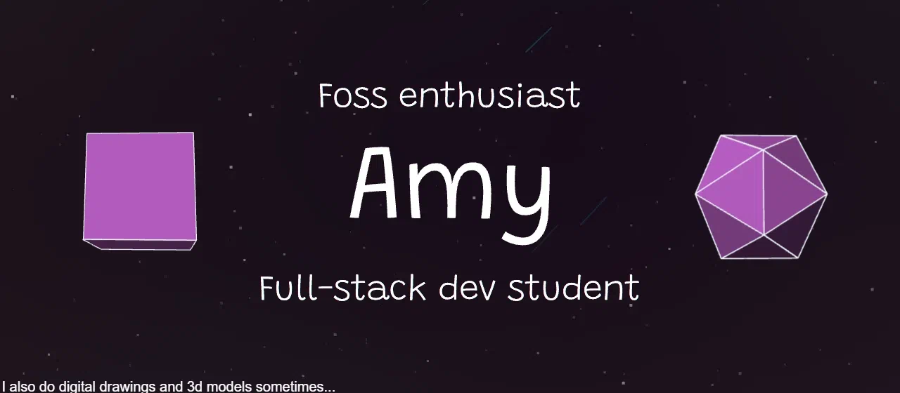
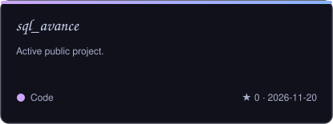
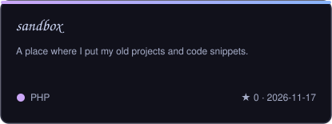
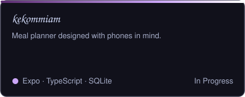
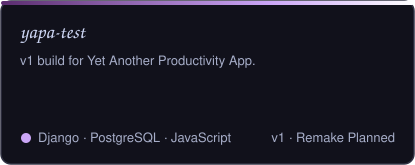
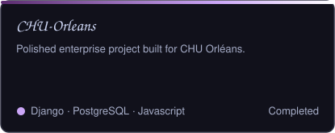
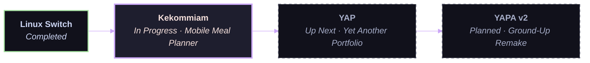
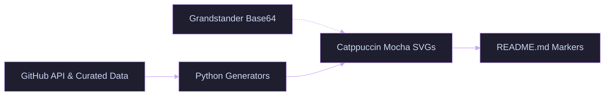

</img>


<!-- CURRENT_PROJECTS:START -->
<div align="center">
  <a href="https://github.com/astralamycal/sql_avance">
    
  </a>
  <a href="https://github.com/astralamycal/sandbox">
    
  </a>
</div>
<!-- CURRENT_PROJECTS:END -->


<!-- HIGHLIGHT_PROJECTS:START -->
<div align="center">
  <a href="https://github.com/astralamycal/kekommiam">
    
  </a>
  <a href="https://github.com/astralamycal/yapa-test">
    
  </a>
  <br />
  <a href="https://github.com/astralamycal/done_Projet-Entreprise-CHU-Orleans">
    
  </a>
</div>
<!-- HIGHLIGHT_PROJECTS:END -->





> **Focus:** Python & web backends, Linux/DevOps tools in addition of code, Knowledge in **FOSS** alternatives, Cost effective **design decisions/optimisations**, **Local AI** usage and automation.

| Domain | Stack |
| :--- | :--- |
| **Frontend & Mobile** |      |
| **Backend & Web** |            |
| **Databases** |     |
| **OS, DevOps & AI** |         |

<details>
<summary><b>Design, Creative & Workflow</b> - Figma, Github Projects...</summary>
<br />

> Shaping interfaces, visual assets, and team workflows around clarity, and open-source tooling.

     

</details>


<div align="center">
<details>
<summary><b>⚙️ Architecture & Build Pipeline</b> — How this profile renders itself</summary>
<br />

```ansi
╭─ astralamycal@arch-profile ───────────────────────────────────╮
│ [1] Sync      current-projects.py  ──▶ recent GitHub pushes    │
│ [2] Curate    highlight_projects.py ──▶ stack & status cards   │
│ [3] Render    Grandstander TTF (b64) ──▶ sandboxed SVG    │
│ [4] Inject    START/END markers      ──▶ README.md synced      │
╰───────────────────────────────────────────────────────────────╯
```

> [!NOTE] 
> **How this profile builds itself:** Rather than keeping every card and badge hand-edited, Python scripts generate Catppuccin Mocha SVGs with Base64-embedded fonts and inject them between markers in `README.md`.


</details>


<br />

<a href="mailto:&#x61;&#x6d;&#x79;&#x2e;&#x63;&#x6f;&#x6e;&#x74;&#x61;&#x6b;&#x74;&#x40;&#x67;&#x6d;&#x61;&#x69;&#x6c;&#x2e;&#x63;&#x6f;&#x6d;?subject=%5BGithub%5D%20Insert%20Subject%20here.&body=How%20can%20I%20help%20you" target="_blank">
  
</a>

<details>
<summary>Copy email address directly</summary>

```text
amy.contakt@gmail.com
```
</details>

<p align="center">
  <sub>Smaller experiments, older snippets & quick prototypes live in my <a href="https://github.com/astralamycal/sandbox">sandbox repository</a>.</sub>
</p>

</div>